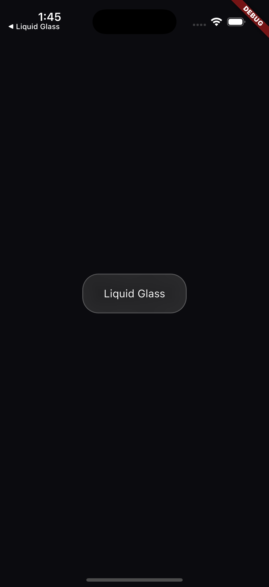

<h1 align="center">🧊 prism_glass</h1>

<p align="center">
  <b>Apple's Liquid Glass material for Flutter — the real <code>UIGlassEffect</code> on iOS 26+,<br/>a fragment-shader approximation everywhere else. One widget for all platforms.</b>
</p>

<p align="center">
  <a href="https://pub.dev/packages/prism_glass"></a>
  <a href="https://github.com/Awaisdev01/prism_glass/actions"></a>
  
</p>



## Why

Flutter's single most-requested missing feature
([flutter/flutter#170310](https://github.com/flutter/flutter/issues/170310),
700+ 👍): Cupertino has no Liquid Glass material. iOS 26 shipped it in
UIKit (`UIGlassEffect`, `UIGlassContainerEffect`), and Flutter 3.50's stable
native interop finally makes it practical to wrap. This package does that —
and keeps a faithful shader fallback so your UI works everywhere.

## Features

- **Native Liquid Glass on iOS 26+** — hosts the system `UIGlassEffect` in a
  platform view: real refraction, real speculars, real interactivity.
- **Universal fallback** — an Impeller fragment shader recreates the glass
  character (frost, rim light, micro-refraction) on Android, web, desktop,
  and iOS < 26.
- **Single API** — `PrismGlassSurface` transparently picks the right path.
- **Live control** — `GlassController` mutates style/tint/radius without
  rebuilding.

## Usage

```dart
import 'package:prism_glass/prism_glass.dart';

PrismGlassSurface(
  style: GlassStyle.regular,
  interactive: true,          // native interactive glass on iOS 26+
  cornerRadius: 24,
  tintColor: Colors.white24,
  child: MyToolbar(),
)
```

## Rebuilding shaders

The fallback shader ships pre-compiled (`shaders/glass.iplr`). After editing
`shaders/glass.frag`, run:

```sh
./tool/compile_shaders.sh
```

## Status

v0.1: native regular/clear styles + interactive glass on iOS 26, shader
fallback elsewhere. Merged glass containers (`UIGlassContainerEffect`) are
next.

## Related

- [flutter/flutter#170310](https://github.com/flutter/flutter/issues/170310) —
  the upstream feature request this package prototypes.
